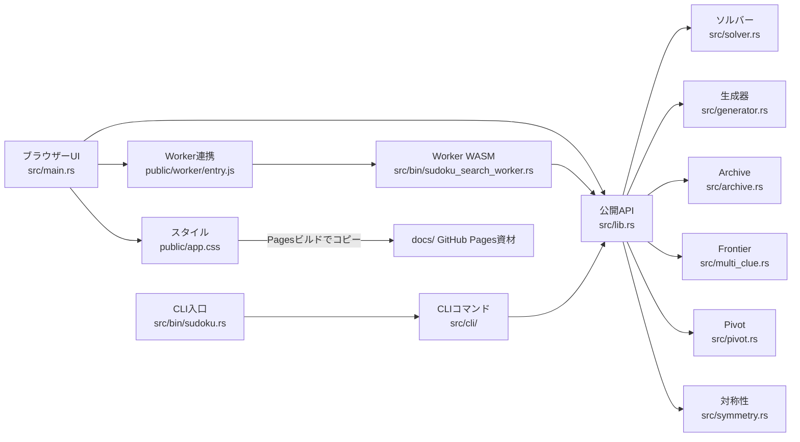

# アプリとコードの構成

## 全体

このリポジトリは、数独の探索処理を提供するRustライブラリと、それを呼び出すDioxus Web UIで構成されています。ソルバーは画面に依存せず、`Matrix`を受け取る関数として公開されています。



## ディレクトリと主要ファイル

| パス | 役割 |
| --- | --- |
| `src/lib.rs` | `Matrix`型、`solve`、`candidates_for`、`find_hint`を公開するライブラリ入口 |
| `src/solver.rs` | 重複チェック、候補計算、ヒント判定、再帰探索、有限予算の一意性判定、単体テスト |
| `src/generator.rs` | Fast生成、ランダム化完成盤面探索、Diverse生成と予算管理 |
| `src/symmetry.rs` | 数独対称変換群に対する盤面の正規形 |
| `src/archive.rs` | Minimal Puzzleの独立検証、証拠、JSON Archive |
| `src/multi_clue.rs` | 複数ヒントの増減探索と再開可能なFrontier |
| `src/pivot.rs` | Solution-Space Pivot探索と並列候補検査 |
| `src/minimal_puzzle_seeds.rs` | ヒント数を添字にした組み込みMinimal盤面配列 |
| `src/main.rs` | 初期盤面、セル入力、テキスト入出力、Solve/Clear、Undo/Redo、検索UI、Fast生成、盤面変換 |
| `src/board_transform.rs` | 数独の制約を保つ盤面対称変換と、その純粋な変換テスト |
| `src/board_analysis.rs` | 重複セル、候補マスク、候補切れの解析と、その単体テスト |
| `src/bin/sudoku_search_worker.rs` | Web Workerから解列挙・問題生成APIを呼び、進捗イベントを送信 |
| `src/bin/sudoku.rs` | オフラインCLIの単一入口とコマンド振り分け |
| `src/cli/mod.rs` | CLI command routing、help、終了時のエラー処理 |
| `src/cli/args.rs` | 数値引数と値引数の共通解析 |
| `src/cli/atomic_file.rs` | CLI checkpoint・JSON出力の一時ファイル作成、同期、atomic rename |
| `src/cli/archive_cmd.rs` | Archiveの入出力、統計、検証、Fast基準盤面登録 |
| `src/cli/minimal_cmd.rs` | Minimal検証・収集コマンドの引数解析と実行委譲 |
| `src/cli/minimal.rs` | Minimal探索のcheckpoint、再開、Archive登録 |
| `src/cli/frontier.rs` | Multi-Clue Frontier降下コマンドと探索進捗保存 |
| `src/cli/pool.rs` | Diverse候補プールの検証・重複排除・再開可能なcheckpoint生成 |
| `src/cli/pool_args.rs` | Diverseコマンドの設定値、CLI引数検証、使用方法 |
| `src/cli/minimal_scan.rs` | 並列minimal-puzzle探索コマンド |
| `src/cli/symmetry_bench.rs` | 正規化benchmarkコマンド |
| `public/worker/entry.js` | ブラウザーWorkerの検索・Fast生成要求をWASMへ中継 |
| `public/app.css` | Web UIのスタイル。ビルド時に配信資材へコピー |
| `sample_problem/` | テキスト形式の問題例 |
| `documentation/` | 編集する解説資料 |
| `docs/` | GitHub Pagesに配置する生成済みWeb資材 |
| `Cargo.toml` / `Cargo.lock` | Rust依存関係と解決済みバージョン |
| `Dioxus.toml` | Webターゲット、公開先、スタイル、Pagesのbase path |

`src/lib.rs`以下のライブラリはUI・Worker・CLIから共有されます。Workerは解列挙とFast生成をWeb UIから分離し、Diverse探索やArchive収集はnative CLIから呼び出します。

## ソルバーの公開API

```rust
pub type Matrix = [[u8; 9]; 9];
pub fn solve(mtx: &mut Matrix) -> bool;
pub fn candidates_for(mtx: &Matrix, x: usize, y: usize) -> Vec<u8>;
pub fn find_hint(mtx: &Matrix) -> Result<Option<Hint>, HintError>;
pub fn check_uniqueness(mtx: &Matrix, max_nodes: u64)
    -> Result<UniquenessCheck, SearchError>;
pub struct SolutionSearch;
impl SolutionSearch {
    pub fn new(mtx: &Matrix) -> Result<Self, SearchError>;
}
impl Iterator for SolutionSearch {
    type Item = SearchEvent;
}
```

`solve`は盤面を直接更新します。解を見つけると`true`を返し、初期数字の重複や探索失敗では`false`を返します。成功時には数字1〜9だけで埋まった盤面になります。戻り値は成否のみで、失敗理由や解の個数は返しません。

`candidates_for`は空欄セルの行・列・3×3ブロックを調べ、置ける数字を昇順の`Vec<u8>`で返します。埋まったセルや盤面外の座標では空のベクターになります。

`find_hint`は唯一候補と隠れたシングル（行・列・3×3ブロック内で、ある数字を置ける場所が1セルだけ）を調べます。盤面を変更せず、位置・数字・手法を返します。探索や仮置きはせず、対応する手法で決まらないことは「解がない」ことを意味しません。

`SolutionSearch`は探索上限を持たないIteratorで、解と2,048ノードごとの進捗イベントを返します。各探索フレームでは候補をビットマスクで保持し、探索ノードごとの候補ベクター確保を避けます。全探索の終端まで消費した場合にだけ解数が確定します。途中でdropすれば探索を止められます。元の盤面は変更しません。UI WorkerはこのIteratorを消費し、UI向けの解数・ノード上限を適用します。

`check_uniqueness`は解を最大2個まで調べる生成向けAPIです。完全終了まで探索した1解だけを`Unique`とし、2解なら`Multiple`、解がなければ`NoSolution`、予算切れなら`Unknown`を返します。ノード上限を確認するイベント間隔のため、観測ノードは指定上限を最大2,047超える場合があります。

`generator::generate_puzzle(seed)`は初期数字30個の問題を返します。`generator::generate_puzzle_with_clues(seed, count)`は17〜81個の範囲で数字数を指定でき、範囲外ではエラーを返します。どちらも一意解の盤面を生成し、同じseedを渡すと同じ盤面を再現します。

`generator::generate_diverse(seed, count, budget)`は17ヒントではFastと共有する検証済み基準盤面から進化的探索を行い、Adaptiveは設定上限まで中間ヒント状態を試した後、`-2+2`、`-1+1`、`-3+3`へ進みます。中間状態の既定上限は18で、APIとオフラインCLIは80まで指定できます。18〜81ヒントではランダム化制約探索で完成盤面を新たに作ります。有限予算で指定数に届かなければエラーになります。Web UIはFastのみを使い、Workerから生成結果を受け取ります。DiverseはRust APIとCLIでのみ利用できます。オフライン収集CLIと対称性同値判定を備え、検証済み基準盤面をFastとDiverseで共有します。詳しくは[問題生成方式](generation.md)を参照してください。

詳細は[アルゴリズム解説](algorithm.md)と[盤面形式・APIの使い方](usage.md)を参照してください。

## UIのデータの流れ

画面は表示言語、盤面、元のヒント数字、メッセージ、テキスト欄をDioxus Signalで保持します。表示文言は意味ベースのキーで`locales/ja.json`と`locales/en.json`から取得し、名前付き引数と数に応じた翻訳形もカタログ側で扱います。探索状態は言語に依存しない形で保持して選択言語に応じた文面を表示します。描画時には`src/board_analysis.rs`で盤面の行・列・ブロックを一度解析し、候補、候補切れ、重複セルの強調と`aria-invalid`判定に再利用します。入力後のメッセージ判定にも同じ盤面解析を使います。翻訳リソースの書き方は[翻訳リソース](i18n.md)を参照してください。

1. 数字セルの入力を`Matrix`へ反映します。初期ヒントのロック状態はデフォルトで有効です。ロックを解除してヒントセルを編集すると、そのセルは初期ヒントではなく通常の入力セルとして扱います。
2. 入力中に重複を検出し、同じ数字が同じ行・列・3×3ブロックにあるセルを強調します。
3. 候補表示をオンにすると、盤面解析で得た候補マスクから数字をセル内へ表示します。候補が0個のセルは別途強調します。ライブラリ利用者向けには`candidates_for`がベクター形式で候補を返します。
4. Solveボタンで重複と候補切れを先に確認し、問題がなければ盤面のコピーをソルバーへ渡します。
5. Count solutionsは現在の盤面をWeb Workerへ渡します。Workerは解を最大100件、探索ノードを約500,000件まで調べ、見つけた盤面と進捗をメッセージで返します。ノード上限はイベント間隔により最大2,047ノード超過する場合があります。
6. Generate puzzleはクリックごとに新しいseedを作り、FastをWeb Workerで実行します。Fastは目標以下のヒント数を持つ検証済みMinimal基準盤面から1組をseedで選び、盤面と解に同じランダム対称変換を100回適用してから、指定数になるまで完成盤面の数字を追加します。UIはFastのみを公開し、初期ヒント数は25です。DiverseはRust APIとCLI専用で、Web Workerへは公開しません。
7. 探索結果は`job_id`を付けて受け取り、現在の検索と異なる古い結果を無視します。クリックから終了・中断までの所要時間を秒で表示し、上限到達と全探索完了を別状態として表示します。
8. 見つかった解は前後ボタンと範囲スライダーで切り替えてプレビューします。元の検索盤面の入力済み数字を強調し、盤面操作では一覧を消さず、利用者が選んだ解だけをUndo可能な盤面変更として適用します。元の検索盤面または見つかった解の状態では、一覧内の解を適用できます。
9. Undo/Redoは盤面と初期ヒントの組を最大100件保持し、盤面を変える操作を復元します。新しい盤面変更が行われるとRedo履歴は破棄されます。
10. 成功時に解を画面へ反映します。探索で解が見つからない場合はメッセージを表示します。
11. テキスト読み込み前に9行×9文字か、使える記号かを検証します。`1`〜`9`は数字、`0`・`.`・`_`は空欄です。
12. テキスト出力では空欄を`_`に置き換えます。
13. 矢印キーで隣のセルへ移動し、数字入力後は次の空欄へフォーカスします。セル上のCtrl/Cmd+Z/Y操作も盤面履歴へ接続します。
14. 対称変換の純粋な盤面処理は`src/board_transform.rs`に置きます。UIは`src/main.rs`から盤面と初期ヒントの両方へ同じband/stack置換、行列置換、数字置換、回転、反転を適用し、通常の盤面変更としてUndo/Redo履歴へ記録します。

## 生成物と編集元を分ける

CSSの編集元は`public/app.css`、Rust UIの編集元は`src/main.rs`、盤面変換ロジックは`src/board_transform.rs`、盤面解析は`src/board_analysis.rs`です。`docs/`は公開用の生成資材なので、手書き解説を置かず、Webアプリの再ビルドで更新します。解説資料の編集元は`documentation/`です。
